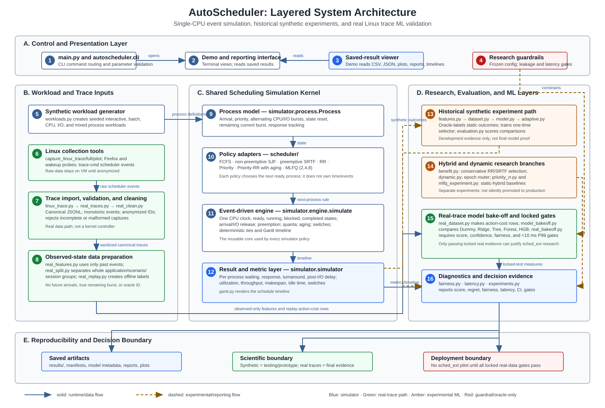

# AutoScheduler System Architecture

**Figure 1.** IEEE-style layered view of AutoScheduler. Solid arrows show runtime/data flow. Dashed arrows show experiment or reporting flow. The red boundaries are deliberate: true-burst SJF, SRTF, and RR20-SRTF are oracle references, and synthetic data cannot establish the final real-world ML result.

## 1. Architecture at a glance

AutoScheduler is a **single-CPU event-driven scheduling simulator**, not a replacement Linux kernel scheduler. It has three connected but scientifically separate paths:

1. The **simulation path** executes scheduling policies against a shared CPU/I/O process model.
2. The **historical synthetic path** explores algorithms and prototype ML safely and reproducibly.
3. The **real-trace path** captures Linux scheduling events, removes sensitive metadata, derives observed-only inputs, and evaluates model families under locked evidence gates.

The same simulation engine is reused across policies. Only the rule for choosing the next ready process changes.

## 2. Diagram component guide

| No. | Component | Technical explanation | Layman analogy |
| --- | --- | --- | --- |
| 1 | `main.py` and `autoscheduler.cli` | Parses commands such as `evaluate`, `model-bakeoff`, and `real-features`; validates arguments; calls the correct workflow. | The reception desk: it hears the request and sends it to the correct department. |
| 2 | Demo and reporting interface | `autoscheduler.demo` presents live comparisons and saved experiment evidence without silently rerunning expensive jobs. | A museum guide showing exhibits already prepared by the researchers. |
| 3 | Saved-result viewer | The demo reads saved CSV, JSON, plots, Gantt timelines, model metadata, and Markdown reports without rerunning expensive experiments. | A museum display case showing results already recorded in the lab notebook. |
| 4 | Research guardrails | `configs/real_desktop_ml.json`, grouped splits, frozen seeds, policy restrictions, and pass gates prevent accidental leakage or overclaiming. | The exam rules and sealed answer sheet. |
| 5 | Synthetic workload generator | `workloads.py` creates reproducible process sets across interactive, batch, CPU-heavy, I/O-heavy, and mixed profiles using fixed seeds. | A flight simulator that creates many safe practice situations. |
| 6 | Linux collection tools | Shell tools use `trace-cmd` scheduler tracepoints while running controlled wakeup, CPU, I/O, Firefox, compression, and mixed workloads. | Cameras watching a real kitchen while different meals are cooked. |
| 7 | Trace import, validation, and cleaning | `linux_trace.py` imports reports; `real_traces.py` validates canonical JSONL; `real_clean.py` removes names, paths, machine identifiers, and rejects incomplete traces. | Translating security-camera footage into a clean, anonymous event diary. |
| 8 | Observed-state data preparation | `real_features.py` computes 16 values only from events before a decision; `real_split.py` assigns whole app/scenario/session groups to one split; `real_replay.py` prepares offline replay inputs. | Giving a student only what was visible before a choice—not tomorrow’s answer key. |
| 9 | `Process` model | Stores process arrival, priority, CPU bursts, I/O bursts, current remaining burst, start/completion state, and post-I/O response delays. | A job card listing when a customer arrives, what work they need, and when they step away and return. |
| 10 | Scheduler policy adapters | `scheduler/` supplies FCFS, SJF, SRTF, RR, Priority, Priority-RR, and MLFQ. Each policy selects the next ready job using its own rule. | Different dispatchers deciding which customer goes next. |
| 11 | Shared event-driven engine | `simulator.engine.simulate` owns time, ready/blocked queues, arrivals, I/O completions, preemption, quantum expiry, aging, context-switch costs, deterministic tie-breaking, and the timeline. | One shared clock and traffic controller that all dispatchers must obey. |
| 12 | Results and metrics | `simulator.simulator` converts completed processes and the timeline into per-process and aggregate metrics; `gantt.py` renders execution order. | The scoreboard plus a replay video after a race. |
| 13 | Historical synthetic experiment path | `features`, `dataset`, `model`, `adaptive`, and `evaluation` create oracle-labelled synthetic comparisons and a one-time decision-tree selector. Its outputs are preserved as prototype evidence only. | Practice tests that help design a lesson, but do not prove performance in the real world. |
| 14 | Hybrid and dynamic research branches | `benefit.py`, `dynamic.py`, `priority_rr.py`, and `mlfq_experiment.py` evaluate conservative RR/SRTF switching, an epoch router, tuned Priority-RR, and MLFQ baselines. | Several controlled prototype vehicles tested on a closed track. |
| 15 | Real-trace model bake-off and locked gates | `real_dataset.py` creates replay-only action-cost labels; `model_bakeoff.py` compares Dummy, Ridge, Decision Tree, Random Forest, and Histogram Gradient Boosting; `real_bakeoff.py` checks score, confidence interval, fairness, data sufficiency, and P99 latency. | A blind taste test where every contestant gets the same ingredients and a final judge sees a sealed test set. |
| 16 | Diagnostics and decision evidence | `fairness.py`, `latency.py`, and `experiments.py` record response/wait fairness, starvation indicators, decision-time percentiles, confidence intervals, and pass/fail gates. | Independent safety inspectors checking speed, fairness, and reliability. |

## 3. Simulator policy map

| Policy | Rule | Preemptive? | Research status |
| --- | --- | ---: | --- |
| FCFS | First ready process runs first. | No | Deployable baseline |
| SJF | Chooses smallest declared total CPU burst. | No | Oracle-only: needs hidden burst knowledge |
| SRTF | Runs smallest remaining current CPU burst. | Yes | Oracle-only: needs hidden remaining work |
| Round Robin | FIFO rotation after a fixed quantum. | Yes | Deployable baseline |
| Priority | Lowest numeric priority runs first. | No | Deployable baseline |
| Priority-RR | Priority scheduling with round-robin, aging, and I/O-return boost. | Yes | Deployable baseline |
| MLFQ | Three feedback queues `(2, 4, 8)` with demotion, I/O boost, and aging. | Yes | Deployable baseline |
| RR20-SRTF | RR warm-up, then SRTF. | Mixed | Oracle-only research comparator |

## 4. Module inventory

### Core runtime

| Package/module | Responsibility |
| --- | --- |
| `main.py` | Compatibility launcher and CLI entry point. |
| `autoscheduler/cli.py` | Command definitions and orchestration. |
| `simulator/process.py` | CPU/I/O process domain model and validation. |
| `simulator/engine.py` | Shared event-driven single-CPU simulation engine. |
| `simulator/simulator.py` | Per-process and aggregate metric calculation. |
| `simulator/gantt.py` | Text Gantt timeline rendering. |
| `scheduler/fcfs.py`, `sjf.py`, `srtf.py`, `round_robin.py`, `priority.py`, `priority_rr.py`, `mlfq.py` | Policy wrappers around the shared engine. |

### Synthetic experiments and diagnostics

| Package/module | Responsibility |
| --- | --- |
| `autoscheduler/workloads.py` | Seeded synthetic workload profiles. |
| `autoscheduler/features.py` | Workload-level synthetic feature extraction. |
| `autoscheduler/dataset.py` | Oracle-labelled synthetic dataset construction. |
| `autoscheduler/model.py` | Decision-tree classifier training/loading. |
| `autoscheduler/adaptive.py` | One-time adaptive policy selection. |
| `autoscheduler/evaluation.py` | Static/adaptive scoring and oracle comparison. |
| `autoscheduler/fairness.py` | Report-only fairness aggregation. |
| `autoscheduler/latency.py` | Decision-time benchmark and latency gate. |
| `autoscheduler/experiments.py` | Evaluation artifact/report helpers. |
| `autoscheduler/priority_rr.py` | Priority-RR configuration tuning. |
| `autoscheduler/mlfq_experiment.py` | MLFQ baseline comparison and latency evaluation. |
| `autoscheduler/benefit.py` | Conservative RR-versus-SRTF benefit-regressor experiment. |
| `autoscheduler/dynamic.py` | Dynamic epoch-routing experiment. |
| `autoscheduler/demo.py` | Read-only terminal presentation menu. |

### Real-trace validation path

| Package/module | Responsibility |
| --- | --- |
| `autoscheduler/real_config.py` | Loads and hashes the frozen real-data contract. |
| `autoscheduler/linux_trace.py` | Imports `trace-cmd report` output. |
| `autoscheduler/real_traces.py` | Canonical trace schema validation and JSONL I/O. |
| `autoscheduler/real_clean.py` | Anonymizes scheduling-relevant trace copies. |
| `autoscheduler/real_features.py` | Extracts the 16 observed-only decision features. |
| `autoscheduler/real_replay.py` | Reconstructs eligible offline replay workloads. |
| `autoscheduler/real_dataset.py` | Produces replay-only per-action cost rows and fairness labels. |
| `autoscheduler/real_split.py` | Group-safe train/validation/test manifests. |
| `autoscheduler/real_synthetic.py` | Trace-shaped development data generator only. |
| `autoscheduler/model_bakeoff.py` | Equal-budget model-family candidate tuning. |
| `autoscheduler/real_bakeoff.py` | Locked-test comparison and gate report. |

### Linux-side tools

| Tool | Responsibility |
| --- | --- |
| `tools/capture_linux_trace.sh` | Records selected scheduler and block-I/O tracepoints. |
| `tools/capture_linux_pilot.sh` | Short pipeline-validation collection. |
| `tools/capture_linux_full.sh` | Full 30-configuration × 10-repetition trace collection. |
| `tools/run_firefox_probe.sh` | Isolated deterministic Firefox desktop workload. |
| `tools/run_wakeup_probe.py` | Controlled sleep/wakeup workload. |

## 5. Evidence and deployment rule

The diagram deliberately separates **model performance** from **deployment permission**. A model may look good in synthetic or replay-only results, but it is not a real Linux scheduler result. The project can consider a bounded `sched_ext` pilot only after a model passes the locked, unseen real-trace score, confidence, fairness, and decision-latency gates in the frozen contract.
