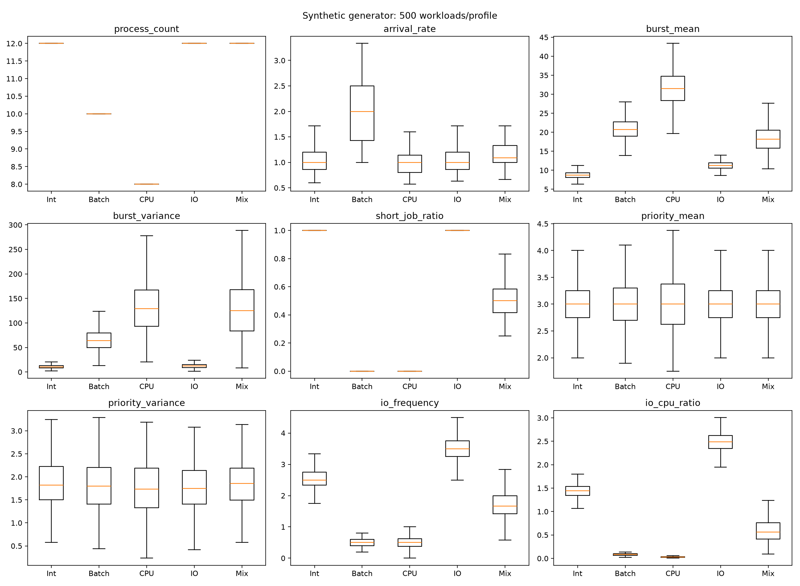
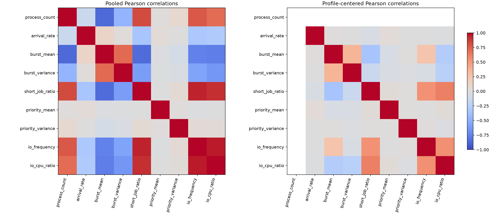
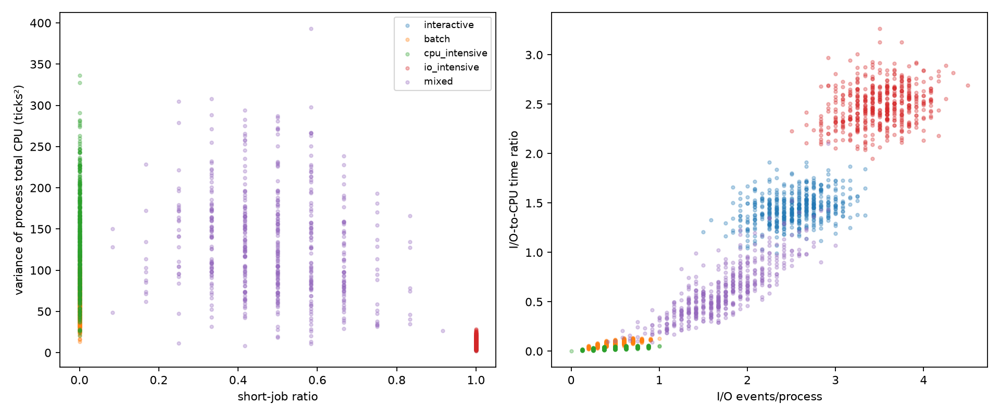

# AutoScheduler workload profile coverage assessment

Assessment date: 2026-10-13. Repository commit: `b0058f1728f2670cfa7226ef49ec336eae4f57a6`.

## 1. Executive Summary

**Verdict: Sufficient for controlled synthetic training but insufficient for realistic generalization.**

The five profiles provide reproducible examples of CPU/I/O heterogeneity and a useful testbed for comparing six policies under a fixed objective. They do not sample five independent or empirically calibrated populations of real applications. Defaults contain only 8, 10, or 12 processes, arrivals are concentrated near the start, service demands have small bounded supports, priorities are independently uniform, and workload characteristics are strongly coupled to profile identity.

This assessment generated **2,500 fresh workloads**, reviewed the saved **2,500 training rows and 1,000 evaluation rows**, ran **99 evaluation-only stress workloads**, and inspected metric contributions on **150 fresh workloads**. No generator, scheduler, model, scoring weight, historical result, or training dataset was modified. All saved training features regenerated exactly, every saved evaluation selection was reproduced by the frozen model, and input hashes remained unchanged. The repository's 68 tests passed in an isolated environment with dependencies installed.

The central findings are:

- All 2,500 fresh default workloads have finite-cohort arrival-window demand/capacity above 5.26. Low-load arrivals are not deliberately represented.
- Profile identity explains 97.95% of short-job-ratio variation and 100% of process-count variation. A descriptive nearest-neighbor check recovers profile identity for 99.68% of fresh workloads. This demonstrates separability, not realistic diversity or proof of classifier shortcut learning.
- RR and SRTF account for 95.76% of training oracle labels and 95.7% of evaluation labels. Priority and Priority-RR have no oracle labels.
- The saved classifier uses three of nine features and predicts only RR/SRTF on the saved evaluation. It chooses RR for every workload in four profiles; all departures from RR occur in mixed workloads.
- Adaptive mean score is 0.131881 versus RR's 0.132212, but the saved paired 95% interval for Adaptive minus RR is **[-0.001275, 0.000595]**. The evidence does not establish improvement over RR.
- On the sampled 100/1,000-process stresses, the frozen model always chooses SRTF and never matches the oracle. Mean regrets are 0.01663/0.01442. These small experiments expose concrete limitations, not population-wide failure rates.

Retain the existing dataset as a versioned baseline. Extend the experimental design through a separate version with independently varied workload dimensions and predefined distribution-shift tests. Increasing same-generator sample counts or adding profile names alone will not resolve the coverage gaps.

Primary evidence: [generator](../autoscheduler/workloads.py), [features](../autoscheduler/features.py), [objective](../autoscheduler/evaluation.py), [training/model metadata](../results/six_policy/model.json), [saved evaluation summary](../results/six_policy/summary.json), and [diagnostic measurements](workload_coverage/output/assessment.json).

## 2. Existing Workload Generator Analysis

### Explicit distributions

In [workloads.py, lines 22–68](../autoscheduler/workloads.py), `randint(a,b)` samples an inclusive discrete uniform distribution, denoted U{a,…,b}. There are no implemented Poisson, exponential, normal, lognormal, or Pareto distributions in the production generator.

| Profile | Default N | Arrival increment after first process | CPU burst count C | Individual CPU burst B | Individual I/O duration I | Total CPU support per process |
|---|---:|---|---|---|---|---|
| Interactive | 12 | U{0,1,2} | U{2,…,5} | U{1,…,4} | U{2,…,8} | 2–20 |
| Batch | 10 | U{0,1} | U{1,2} | U{8,…,20} | U{2,…,5} | 8–40 |
| CPU-intensive | 8 | U{0,1,2} | U{1,2} | U{12,…,30} | U{1,…,3} | 12–60 |
| I/O-intensive | 12 | U{0,1,2} | U{3,…,6} | U{1,…,4} | U{4,…,12} | 3–24 |
| Mixed | 12 | Determined by incoming process's sampled type | Mixture of above | Mixture of above | Mixture of above | 2–60 |

Every process has C−1 I/O intervals between CPU bursts and a priority drawn from U{1,…,5}, independent of its designated type. Lower numeric priority means higher urgency. N is deterministic per profile; a caller can override it with a positive `process_count`, but [dataset.py](../autoscheduler/dataset.py) and [experiments.py](../autoscheduler/experiments.py) do not do so. Higher counts appear in the separate latency benchmark; that benchmark does not establish scheduling-quality generalization.

The first process arrives at zero. Later arrivals accumulate nonnegative increments, so simultaneous arrivals are allowed and the sequence is a finite renewal-style construction. The batch profile is especially concentrated. Variable bounded gaps do not make these arrivals Poisson: a continuous homogeneous Poisson process has exponential gaps, whereas these increments have finite integer support and positive probability of zero. No time unit is calibrated to seconds or actual CPU cycles.

Total CPU demand is a random sum `sum(B_1,…,B_C)`, not a direct uniform draw. Its shape emerges from burst-count and burst-duration draws. I/O-to-CPU ratio is also derived, not independently sampled. Theoretical per-process mean CPU demands are 8.75, 21, 31.5, 11.25, and 18.125 ticks for the five profiles respectively. Expected individual CPU means are 2.5, 14, 21, and 2.5 for the four base types. These are analytic consequences of the implementation, not observed application statistics.

### Mixed sampling and dependence

Mixed chooses one of the four base types with equal probability **for each process**, with replacement. Type counts therefore have a multinomial distribution conditional on N=12. It neither guarantees all four types nor assigns one type to an entire workload. The incoming process's type also chooses its arrival-gap distribution. This couples arrival timing, CPU demand, burst count, and I/O behavior instead of varying them independently.

The marginal mixed arrival probabilities are P(gap=0)=3/8, P(gap=1)=3/8, and P(gap=2)=1/4; mean=0.875 and variance=0.609375. Its pooled individual-burst distribution weights types by their numbers of bursts, so it is **not** an equally weighted mixture over individual bursts. Likewise, a ratio of expected total I/O and expected total CPU is not generally the expectation of the per-workload ratio.

All draws use a local `random.Random(seed)`. Repeated profile, seed, and N reproduce the same workload without changing global random state. Saved static training seeds are `42*10^7 + profile_index*10^6 + sample_index`; held-out seeds use 2026 instead of 42. The distinct seeds prevent exact cohort reuse, but both sets follow the same generator distribution. Fixed-seed regeneration was verified; Python/package versions and hashes are recorded in the diagnostic manifest.

## 3. Statistical Characteristics of Each Profile

### Protocol and metric definitions

Fresh samples use base seed **73013**, 500 workloads per profile, and seed formula `73013*10^7 + profile_index*10^6 + sample_index`, with profile order from `PROFILES`. These seeds do not overlap saved training/evaluation seeds. All statistics describe synthetic simulated workloads.

- Variances use population convention (`ddof=0`). Quantiles use NumPy's default linear interpolation.
- Arrival intervals are sorted consecutive arrival differences, including zero gaps and excluding an artificial interval before the first arrival.
- **Total CPU per process** means the sum of that process's CPU bursts. **Total workload CPU demand** sums all processes. Both are reported to avoid ambiguity.
- The existing **short-job ratio** counts processes whose **mean individual CPU burst ≤4**, not total CPU ≤4. The diagnostic **long-job ratio** counts total CPU >40 ticks; 40 is an explicitly chosen reporting threshold, not a real-system boundary.
- I/O frequency is mean I/O-event count per process. I/O-to-CPU ratio is total I/O duration / total CPU duration within a workload, then averaged over workloads.
- Arrival burstiness is described by zero-gap fraction, peak arrivals in one tick, and Fano factor `variance(A_t)/mean(A_t)` for one-tick arrival counts over the finite arrival window. These finite, conditioned counts are not a test for a Poisson process or a measure of long-range dependence.
- CPU-demand concentration is maximum process share and HHI `sum((CPU_i/total_CPU)^2)`; equal shares give HHI=1/N.
- Observation window **W=max(arrival)−min(arrival)+1** ticks, and offered-load proxy **L=total_CPU/W** for one CPU. This measures finite-cohort submitted demand relative to arrival-window capacity. It is not steady-state utilization: work continues after W and I/O can leave the CPU idle. An idle-gap or utilization measurement is needed alongside L.

Per-workload data and full mean/variance/median/P95/min/max summaries are in [workloads.csv](workload_coverage/output/workloads.csv) and [assessment.json](workload_coverage/output/assessment.json). Mean of within-workload variances differs from pooled variance because workload means differ.

### CPU demands and arrival intervals

CPU-total quantiles below pool **processes**; burst and gap statistics pool individual bursts/gaps. Maxima are observed sample maxima, not theoretical upper bounds.

| Profile | Workloads / processes | CPU total mean / median / P95 / max | CPU total variance | Individual burst mean / variance | Arrival gap mean / variance |
|---|---:|---|---:|---|---|
| Interactive | 500 / 6,000 | 8.764 / 9 / 15 / 19 | 11.935 | 2.485 / 1.251 | 0.989 / 0.657 |
| Batch | 500 / 5,000 | 20.856 / 19 / 35 / 40 | 71.241 | 13.872 / 13.988 | 0.503 / 0.250 |
| CPU-intensive | 500 / 4,000 | 31.515 / 29 / 53 / 60 | 155.129 | 21.014 / 30.283 | 1.017 / 0.662 |
| I/O-intensive | 500 / 6,000 | 11.275 / 11 / 18 / 23 | 13.639 | 2.505 / 1.243 | 0.992 / 0.668 |
| Mixed | 500 / 6,000 | 18.404 / 14 / 43 / 59 | 142.360 | 6.791 / 56.244 | 0.877 / 0.609 |

| Profile | Workload CPU demand mean / median / P95 / max | Mean short ratio | Mean long ratio (>40 total CPU) | Mean I/O frequency | Mean I/O:CPU |
|---|---|---:|---:|---:|---:|
| Interactive | 105.164 / 105 / 126 / 143 | 1.000 | 0.000 | 2.526 | 1.444 |
| Batch | 208.556 / 207 / 253 / 280 | 0.000 | 0.000 | 0.503 | 0.083 |
| CPU-intensive | 252.122 / 252 / 313.05 / 357 | 0.000 | 0.289 | 0.500 | 0.031 |
| I/O-intensive | 135.300 / 135 / 157 / 176 | 1.000 | 0.000 | 3.501 | 2.488 |
| Mixed | 220.842 / 218 / 292.05 / 366 | 0.484 | 0.069 | 1.710 | 0.605 |

| Profile | N | Pooled priority mean / variance | Mean zero-gap fraction | Mean Fano | Mean peak arrivals/tick | Mean largest CPU share / HHI | Mean L / minimum L |
|---|---:|---|---:|---:|---:|---|---|
| Interactive | 12 | 2.992 / 2.019 | 0.334 | 0.824 | 2.970 | 0.139 / 0.095 | 9.266 / 5.267 |
| Batch | 10 | 3.009 / 1.997 | 0.497 | 0.581 | 3.658 | 0.164 / 0.115 | 42.215 / 20.000 |
| CPU-intensive | 8 | 2.988 / 1.994 | 0.323 | 0.707 | 2.516 | 0.199 / 0.143 | 34.194 / 15.077 |
| I/O-intensive | 12 | 2.993 / 1.969 | 0.338 | 0.807 | 2.924 | 0.128 / 0.092 | 12.030 / 5.765 |
| Mixed | 12 | 3.022 / 2.010 | 0.374 | 0.827 | 3.118 | 0.192 / 0.115 | 22.251 / 9.500 |

There are no large CPU-demand outliers under the defaults: the observed maximum total CPU is 60 ticks and the largest process contributes at most 29.8% of a sampled mixed workload's demand. This is bounded heterogeneity, not a heavy tail. Significant initial arrival concentration coexists with moderate one-tick Fano factors; those summarize different aspects of arrival shape.

Under the defined arrival window, the production support actually excludes L≤1: even the smallest possible interactive/mixed total demand is at least 2N, while W≤2(N−1)+1. The other base profiles have still higher minimum demand. This is a finite-window statement, not a proof that utilization is always high.

On the separate 30-workload/profile metric audit, RR mean CPU utilization is 97.38%, 100%, 99.97%, 97.02%, and 99.48%, respectively. The minimum is 89.02% in mixed workloads. Defaults can produce I/O-related idle gaps, but this sample does not represent a broad low-utilization regime.

## 4. Coverage Matrix

“Adequately represented” below means that the **basic mechanism is covered for controlled synthetic experiments**, not that its distribution is realistic or exhaustive. Static-training coverage is distinguished from separate simulator capabilities and dynamic experiments.

| Dimension | Classification | Evidence and boundary |
|---|---|---|
| CPU-bound | Adequately represented | CPU-intensive: 12–30-tick bursts, 1–2 bursts, zero/one brief I/O; low mean I/O:CPU ≈0.031. Duration range is narrow. |
| I/O-bound | Adequately represented | I/O-intensive: 3–6 short CPU bursts and 2–5 longer I/O waits; mean I/O:CPU ≈2.488. No device contention. |
| Interactive | Partially represented | Short repeated CPU/I/O cycles exist. No user think-time model, request latency objective, feedback arrivals, or explicit response sensitivity class. Response metric is first dispatch only. |
| Batch | Adequately represented | Longer demands, 10 jobs with compact arrivals and queued competition. No empirical batch population, dependencies, or parallel jobs. |
| Mixed | Adequately represented | Per-process type mixture supports concurrent heterogeneous demand. Mixture weights are fixed and only the four bounded types are available. |
| Bursty arrivals | Partially represented | Zero increments create simultaneous arrivals; about half of batch gaps are zero. No configurable burst/silence cycles or correlated arrival process. |
| Poisson-like arrivals | Missing | Discrete bounded uniform increments, rather than exponential gaps. Generic variability is present, Poisson distributional coverage is absent. |
| High system load | Adequately represented | Finite arrival cohorts submit much more CPU work than can execute during W. Sustained steady-state saturation is not tested. |
| Low system load | Missing | No deliberate sparse-arrival regime. I/O-related idle gaps provide incidental limited exposure, not broad low-load coverage. |
| High process counts | Missing from training/quality evaluation | Default N is 8/10/12. Override and a 1,000-process latency benchmark exist; stress results show that capability is not quality validation. |
| Priority-sensitive | Partially represented | Priorities 1–5 and priority policies exist. No skewed urgency arrivals, deadlines, or priority-weighted oracle objective; priority statistics share the same population distribution. |
| Starvation-prone competition | Partially represented | Waiting tails and threshold-based starvation counts occur. No sustained short-job/urgent-job stream designed to deny an existing process service. Finite positive-demand cohorts eventually complete. |
| Heavy-tailed CPU demand | Missing | Burst and total-demand supports are bounded and small. Mixed demand is heterogeneous but bounded. |
| Time-varying workloads | Partially represented, separate experiment | Static mix has no regime schedule. `dynamic.py` injects three distinct profile cohorts at 0/20/40; same underlying distributions and fixed transitions. No repeated/novel regimes or within-process distribution changes. |
| Context-switch pressure | Partially represented | RR q=2, tuned Priority-RR q=1, I/O returns and SRTF preemption generate switching. Only Priority-RR pays simulated switching cost; no shared cost/quantum sweep. Switching is an outcome, not a workload type. |

## 5. Realism Assessment

The CPU-bound and I/O-bound distinctions have meaningful scheduler consequences: long runnable intervals favor different dispatch behavior from short CPU bursts that block. The process model correctly preserves alternating CPU/I/O work and excludes I/O duration from waiting time. That is a useful foundation. However, independent fixed-duration I/O delays do not model a shared storage device, queueing, network contention, or service dependencies. Interactive I/O waits are not necessarily equivalent to human think time.

“Batch” and “CPU-intensive” overlap in individual CPU duration (12–20 ticks) and both have one or two bursts. Their default process counts and arrival increments help distinguish them. Conversely, interactive and I/O-intensive have identical individual CPU supports and N; their burst counts overlap (3–5) and I/O ranges overlap (4–8). Thus base mechanisms overlap even though the aggregated feature combinations usually reveal the generating profile.

No calibration reference accompanies `_SETTINGS`. Equal per-process mixed probabilities do not establish real-world prevalence. All service requirements and future arrivals are known to the static feature extractor before scheduling; real OS deployment would need observations, estimates, or predictions at the decision time. SJF ranks **total process CPU demand**, while SRTF ranks **remaining current CPU-burst time**. Conclusions concern those concrete implementations, not a universal optimality ordering.

Context-switch cost is one simulated tick for Priority-RR and zero for the other policies in the saved experiment. A one-tick cost with q=1 can be substantial, while RR's q=2 switches remain free. This asymmetry is a documented modeling choice and an important sensitivity gap. The assessment did not change it or infer a counterfactual winner from it.

## 6. Feature-Space Diversity Analysis







The nine features vary across workloads, but their effective independent coverage is smaller than their count suggests.

| Feature | Fresh-sample behavior | Between-profile share of variation (η²) | Saved model impurity importance |
|---|---|---:|---:|
| Process count | Constant within profile; only 8/10/12 globally | 1.000 | 0 |
| Arrival rate | Variable but constrained by N and bounded cumulative gaps | 0.337 | 0 |
| CPU total mean | Strongly profile-linked | 0.888 | 0.0221 |
| CPU total variance | Broader mixed/CPU range; correlated with mean | 0.664 | 0.2843 |
| Short-job ratio | Exactly 1 for interactive/I/O; 0 for batch/CPU | 0.980 | 0.6936 |
| Priority mean | Shared U{1,…,5} population, weak profile separation | 0.0008 | 0 |
| Priority variance | Shared population; finite-N effects | 0.0079 | 0 |
| I/O frequency | Mainly determined by type's burst count | 0.936 | 0 |
| I/O:CPU ratio | Strongly type-linked | 0.969 | 0 |

η² is `1 − within_profile_sum_of_squares / total_sum_of_squares`, computed descriptively on the balanced fresh sample. It measures association with generator identity, not real-world explanatory power. No feature is exactly constant globally. Process count and the pure-profile short ratio are exactly constant within their profiles; priority mean/variance fluctuate around a shared population mean 3/variance 2, rather than encoding intentionally different urgency regimes. The expected within-workload priority population variance is `2*(N−1)/N`, so some apparent profile difference is a finite-count effect.

Strong pooled Pearson correlations include I/O frequency versus I/O:CPU **0.960**, short ratio versus I/O frequency **0.943**, short ratio versus I/O:CPU **0.912**, and N versus CPU mean **−0.864**. After removing profile means, the first two correlations fall to **0.544** and **0.533**. Much of their pooled association reflects the generator's coupled profile definitions; the residual still contains structural dependence. A correlation does not identify which feature causes a policy to win.

The blank process-count row/column in the profile-centered chart is undefined correlation: removing profile means leaves zero variance for N. It should not be interpreted as zero association.

A leave-one-out nearest-neighbor descriptive check standardized all nine features by their pooled mean and standard deviation, then assigned each workload its nearest other workload's profile. It correctly identifies **2,492/2,500 (99.68%)**. Seven mixed workloads and one interactive workload are confused. The pooled scaling uses the descriptive sample and this is not a predictive validation split, classifier retraining, or an estimate of scheduling generalization. It establishes that the generator's named groups are usually separable in this feature representation, despite overlapping individual CPU/I/O supports.

Mean and variance omit arrival autocorrelation, burst scheduling order, tails/maxima, service-demand concentration, priority-demand association, and per-process CPU/I/O correlations. Two workloads can share these nine summaries yet have different competition. The model's zero importances mean “not used by this fitted tree,” not “universally uninformative.” Dropping features solely on that basis would be premature.

## 7. Oracle-Label and Class-Imbalance Analysis

### Saved labels and profile performance

Training counts below come directly from [training.csv](../results/six_policy/training.csv); evaluation counts come from [evaluation.csv](../results/six_policy/evaluation.csv). Both have six score columns, but only four oracle classes occur.

| Profile | Train FCFS | Train SJF | Train SRTF | Train RR | Train Priority / Priority-RR | Evaluation FCFS / SJF / SRTF / RR |
|---|---:|---:|---:|---:|---:|---|
| Interactive | 27 | 3 | 162 | 308 | 0 / 0 | 7 / 1 / 83 / 109 |
| Batch | 0 | 1 | 12 | 487 | 0 / 0 | 0 / 1 / 3 / 196 |
| CPU-intensive | 0 | 0 | 27 | 473 | 0 / 0 | 0 / 0 / 9 / 191 |
| I/O-intensive | 45 | 1 | 120 | 334 | 0 / 0 | 18 / 0 / 51 / 131 |
| Mixed | 0 | 29 | 216 | 255 | 0 / 0 | 0 / 16 / 89 / 95 |
| Total | 72 | 34 | 537 | 1,857 | 0 / 0 | 25 / 18 / 235 / 722 |

RR accounts for **74.28%** of training labels and **72.2%** of evaluation labels; SRTF accounts for **21.48%** and **23.5%**. The remaining training shares are FCFS 2.88% and SJF 1.36%. No amount of classifier fitting on these labels teaches it to select a class that never appears. This limits a claim of six-way adaptive capability; it does not make a negative-result experiment invalid. Equal profile sample counts do not imply balanced algorithm labels, and forcing equal labels would change the target distribution.

| Profile | Adaptive accuracy | Constant-RR label accuracy | Mean regret | Model selections RR / SRTF | Mean adaptive score minus RR |
|---|---:|---:|---:|---:|---:|
| Interactive | 54.5% | 54.5% | 0.010727 | 200 / 0 | 0 |
| Batch | 98.0% | 98.0% | 0.000276 | 200 / 0 | 0 |
| CPU-intensive | 95.5% | 95.5% | 0.000624 | 200 / 0 | 0 |
| I/O-intensive | 65.5% | 65.5% | 0.008564 | 200 / 0 | 0 |
| Mixed | 55.0% | 47.5% | 0.013260 | 78 / 122 | −0.001656 |
| Overall | 73.7% | 72.2% | 0.006690 | 878 / 122 | −0.000331 |

The saved tree has depth 3 and minimum leaf size 10, selected by validation regret rather than maximum accuracy. Its root tests short-job ratio ≤0.291667; other splits use CPU-total variance and mean. It uses no priority, arrival, process-count, or explicit I/O features. All evaluation choices outside RR occur in mixed workloads. These observations are consistent with generator-dependent learning, but do not prove it is merely recognizing profiles: variance-sensitive competition can be a meaningful scheduling signal. Conditional/matched experiments or held-out parameter families would be needed to distinguish those explanations causally. No model was retrained here.

The validation-frozen strongest constant baseline is RR. Its held-out mean score is **0.132212**, versus adaptive **0.131881**, SRTF **0.167733**, and oracle **0.125191**. Adaptive gains only 1.5 percentage points in label accuracy over constant RR. The saved paired bootstrap interval crosses zero; the adaptive statistical gate remains false. The mixed-profile paired interval also crosses zero. High batch accuracy mainly reflects RR's near-universal oracle dominance there.

### Why RR/SRTF dominate: evidence and unresolved attribution

1. **Demand/arrival regime:** compact arrival cohorts, short I/O-heavy bursts, and free RR/SRTF switching expose a particular response/flow-time tradeoff. Stress tests change oracle distributions when those conditions change. That establishes distribution sensitivity, but the stresses are not a controlled factorial attribution of every mechanism.
2. **Objective:** weights are waiting 0.30, first response 0.25, turnaround 0.20, utilization penalty 0.15, throughput penalty 0.10. No direct urgency, deadline, fairness, tail-response, or post-I/O-response term is included. Priority policies can improve priority-class delay without winning this aggregate objective.
3. **Metric redundancy, established algebraically:** for a fixed workload, mean turnaround equals mean waiting plus the fixed mean of CPU+I/O service. Therefore their within-workload normalized values are identical. Utilization=`total_CPU/makespan` and throughput=`N/makespan` are proportional across policies and have identical normalized penalties. The five terms therefore represent **at most three distinct normalized quantities**: 0.50 normalized waiting/turnaround, 0.25 normalized first response, and 0.25 normalized utilization/throughput penalty. This is a description of the existing score, not a proposed weight change. The 150-workload audit confirms the paired normalized values agree to <4×10⁻¹⁶.
4. **Metric audit:** on those 150 workloads, RR's average response contribution is 0.000053, versus SRTF 0.133099 and SJF 0.186085. SJF's waiting contribution is 0.001916 versus RR 0.076121. These directly expose the response versus waiting tradeoff under the actual fixed weights.
5. **Configuration/cost:** Priority-RR pays cost=1 with tuned q=1; others pay zero. In the 150-workload audit it is worst for waiting/turnaround, utilization, and throughput, receiving their full combined 0.75 penalty. Its poor extremes also affect six-policy min-max normalization for the other policies. Scores consequently depend on the candidate set. No cost-matched ablation was run, so no claim is made about the winner after correcting or changing assumptions.
6. **Correlations and tree capacity:** feature coupling and a shallow tree may limit minority decisions. Saved deeper candidates did not improve validation regret, which does not support a simple “increase tree depth” remedy. Correlation/importance cannot by themselves apportion causation among generator, objective, configuration, and model.

Thus RR's win is a real result **within the specified simulator/objective/configuration**, while its transfer to different scheduling goals or costs remains unestablished.

## 8. Generalization Risks

The saved training feature envelope includes N only 8–12, arrival rate 0.571–5, CPU-total mean 6.167–44.125, CPU-total variance 2.222–373.410, I/O frequency 0.1–4.5, and I/O:CPU 0.00495–3.1607. These observed extrema are not the full mathematical support of the generator. Outside an observed feature range is a useful alarm, but being inside all marginal ranges does not establish that a joint workload or temporal structure is familiar. Decision trees route out-of-range values to existing leaves; they provide no distributional extrapolation guarantee or built-in rejection mechanism here.

### Evaluation-only stress experiments

All stresses keep the saved model, six policies, weights, RR q=2, and frozen Priority-RR configuration. Base seed is 73013; stress seed is `73013*100000 + family_index*1000 + sample_index`. Family order is the table order. There are 12 seeds/family except N=1,000 uses three. No stress row is added to training. Full definitions and rows: [assess.py](workload_coverage/assess.py), [stress.csv](workload_coverage/output/stress.csv).

| Family | Explicit construction | n | Oracle distribution | Accuracy | Mean regret | Adaptive minus RR | Outside saved feature envelope |
|---|---|---:|---|---:|---:|---:|---:|
| count_100 | Existing mixed generator with N=100 | 12 | SJF 8, RR 4 | 0% | 0.01663 | +0.00907 | 12 |
| count_1000 | Existing mixed generator with N=1,000 | 3 | SJF 3 | 0% | 0.01442 | +0.00542 | 3 |
| poisson_arrivals | Mixed demands; cumulative exponential gaps of mean 5, rounded cumulative arrivals to ticks | 12 | SRTF 8, RR 4 | 91.7% | 0.00382 | −0.02540 | 12 |
| sparse_arrivals | Mixed demands, arrivals 200 ticks apart | 12 | FCFS 12, ties | 0% | 0 | 0 | 12 |
| bursty_arrivals | Mixed demands, four arrivals at each of 0/60/120 | 12 | SRTF 7, RR 5 | 50.0% | 0.01748 | −0.00291 | 12 |
| heavy_tail | Mixed burst counts/I/O; CPU bursts `round(3*Pareto(α=1.2))`, clipped to 1–500 | 12 | SRTF 9, RR 2, SJF 1 | 33.3% | 0.02749 | −0.00980 | 9 |
| extreme_io | Mixed arrivals; each process has eight CPU bursts of 1 and seven I/O waits of 100 | 12 | FCFS 12, ties | 0% | 0 | 0 | 12 |
| urgent_minority | Mixed demands/arrivals; last process priority 1, others 20 | 12 | RR 10, SRTF 2 | 33.3% | 0.03933 | +0.03002 | 12 |
| phase_shift | Existing dynamic generator with batch/I/O/CPU cohorts injected at 0/20/40 | 12 | RR 9, SRTF 2, SJF 1 | 25.0% | 0.01901 | +0.01804 | 12 |

These are deliberately diagnostic synthetic constructions, not observations of real systems. Rounding exponential arrival times produces a discretized approximation, not an exact continuous Poisson process. The clipped Pareto is an outlier stress inspired by a heavy-tailed parent distribution, not an asymptotically heavy-tailed bounded sample model. Changing mixed burst sizes while retaining I/O deliberately breaks production coupling. The urgent-minority stress cannot establish success at serving urgency because the oracle still ignores priority-specific objectives.

For sparse arrivals and extreme I/O, multiple policies tie for best in all 12 workloads. The deterministic oracle chooses FCFS first, while the model's alternatives achieve the same score. Zero label accuracy there is **not a scheduling performance failure**. RR utilization averages 8.99% and 13.33% respectively, showing that these stresses reach low-utilization conditions absent from the default design. Regret and ties must accompany accuracy.

N=100/1,000 stresses expose a stronger issue: the frozen model always chooses SRTF, yet SJF/RR win and regret is nonzero. These show a concrete quality gap beyond the default counts. They do not establish algorithm decision-latency scalability; that is a different benchmark. Only three N=1,000 samples were run.

The phase-shift row evaluates the **static selector** on the complete combined workload, with future cohorts known. It does not test online adaptation by the dynamic model. Separately, the saved [dynamic summary](../results/six_policy/dynamic/dynamic_summary.json) reports 1,000 traces: adaptive-minus-RR P95 response difference +176.07 ticks, 95% interval [168.75,183.59], so its response gate fails despite passing weighted-score/latency gates. The dynamic experiment uses fixed cohort offsets and known base types; it does not establish generalization to novel transition schedules or behavior distributions.

These exploratory stresses were not preregistered, have small per-family counts, and have no inferential confidence intervals. They demonstrate possibilities and guide a future evaluation protocol; they do not estimate real-world frequencies or statistically rank generalization across families.

## 9. Comparison With Published Workload Characteristics

The primary-source review supports the dimensions to investigate, not the project's numeric choices. Detailed citations and abstraction caveats are in [literature_notes.md](workload_coverage/literature_notes.md).

| Source | Supported characteristic | Implication and transfer limit |
|---|---|---|
| [Arpaci-Dusseau & Arpaci-Dusseau, OSTEP, Scheduling: Introduction](https://pages.cs.wisc.edu/~remzi/OSTEP/cpu-sched.pdf), §§7.1, 7.4–7.9 | Arrival timing, demand heterogeneity, CPU/I/O overlap, response/turnaround tradeoff, switching overhead | These dimensions belong in evaluation. Textbook examples do not calibrate N, durations, or mixture probabilities. |
| [OSTEP, Multi-Level Feedback Queue](https://pages.cs.wisc.edu/~remzi/OSTEP/cpu-sched-mlfq.pdf), §§8.1–8.3 | Interactive CPU relinquishment, starvation, and changing process behavior | Stationary mixtures do not cover all temporal behavior; starvation is a scheduling outcome. |
| [Harchol-Balter & Downey, Exploiting Process Lifetime Distributions for Dynamic Load Balancing, TOCS 15(3), 1997](https://www.cs.cmu.edu/~harchol/Papers/TOCS.pdf), §§1.2, 1.4.2, 2.1 | Historical academic UNIX traces have heavy-tailed total process CPU lifetimes and serially correlated, burstier-than-Poisson arrivals | Motivates testing beyond bounded independent demand/gaps. The finding concerns total CPU lifetimes in a specific historical population, not a universal modern individual-burst distribution. |
| [Google, ClusterData 2019](https://github.com/google/cluster-data/blob/master/ClusterData2019.md) and [official v3 schema](https://raw.githubusercontent.com/google/cluster-data/master/clusterdata_trace_format_v3.proto) | Cluster scheduling events, resource requests/usage and interval CPU summaries; storage access patterns excluded | Useful for heterogeneity and temporal characterization. Cluster scheduling events and aggregate usage do not uniquely specify per-process CPU/I/O burst sequences for one CPU. |
| [Parallel Workloads Archive, Standard Workload Format](https://www.cs.huji.ac.il/labs/parallel/workload/swf.html), fields 2–6,15–18 | Job submit time, waiting time, wall-clock runtime, allocated processors, average CPU time/processor, and optional dependencies/think time | Supports job-level workload characterization. Parallel-job wall time is not one CPU burst; no ordered CPU/I/O sequence is provided. Recorded waits/starts reflect the original scheduler. |

No consulted source validates the selected integer ranges, fixed default counts, uniform priorities, or equal mixed probabilities. These remain project-specific assumptions. Poisson arrivals should be a controlled comparison regime, not a claim that real arrivals are always Poisson. Real traces would require a validated abstraction mapping; deriving missing burst sequences from aggregate cluster usage is an additional model, not direct trace replay. Prefer runnable/blocked OS-level transitions where obtainable and document estimation, units, censoring, and original-scheduler effects.

## 10. Recommended Improvements

These are future proposals; none was implemented in production or incorporated into training. Complexity refers to simulator/experiment work, not the potentially larger effort of trace acquisition. Priorities concern scientific validity, not maximizing classifier accuracy.

| Rank / priority | Recommendation and exact limitation | Supporting evidence | Expected benefit | Drawback | Complexity |
|---|---|---|---|---|---|
| 1 / Critical | Define the target population, decision-time information, and success claim before expanding the dataset | No time-unit/range calibration; static features know future demands; adaptive statistical gate fails | Makes “coverage” and generalization falsifiable; preserves useful negative findings | Narrows or delays broad deployment claims | Low design effort; empirical calibration may be high |
| 2 / High | Independently vary N, arrival rate/load, and arrival shape in a versioned design; include sparse, simultaneous, exponential, and burst/silence regimes | Defaults N=8/10/12; every fresh L>5.26; larger-count stresses have nonzero regret | Separates count/profile effects and covers low/high competition | Combinatorial design and longer simulations | Medium; start with a small balanced/fractional design |
| 3 / High | Expand demand and CPU/I/O distributions independently, including broad/long-tailed total-demand stresses and varied mixture proportions | All production demands bounded ≤60; η² and correlations reveal coupling; clipped-tail stress regret 0.02749 | Tests previously absent tail/concentration and joint conditions | Poorly chosen tails can be unrealistic and expensive; must distinguish total demands from individual bursts | Medium |
| 4 / High | Freeze distribution-held-out evaluation groups and tie-aware metrics before any future dataset extension | Same-generator seed holdout; 99.68% descriptive profile recognition; ties cause 0% accuracy with zero regret | Measures transfer across ranges/families; prevents optimistic reuse of stress sets | Less training data and wider uncertainty; exploratory stresses become development data | Low–medium |
| 5 / High | Predefine policy-cost/quantum sensitivity and justify the objective; report raw metrics and paired regret alongside score | Only Priority-RR charged; normalized metric pairs duplicate; RR response term explains tradeoff; no urgency objective | Clarifies why winners change and which goals are supported | Additional runs; alternative objectives are separate studies, not fixes to old results | Medium; preserve all historical weights/results |
| 6 / High | Expand temporal evaluation before asserting online generalization: offsets, repeats, dwell lengths, cohort sizes, and within-process changes | Dynamic cohorts fixed at 0/20/40; saved P95-response gate fails | Distinguishes stationary profile classification from adaptation | State-space/runtime growth; transition generator must remain interpretable | Medium |
| 7 / Medium | Test priority-demand/arrival association and urgent minorities against a declared urgency criterion | Uniform priorities; zero priority labels/importances; oracle has no urgency term | Establishes whether priority policies solve an intended target | A priority objective changes the question and cannot be compared as the same historical score | Low–medium for workloads; separate objective review |
| 8 / Medium | Audit feature sufficiency with conditional/ablation studies in a separate future experiment; consider tail/concentration and arrival-structure summaries only when justified | Six unused features; nine summaries discard order/tails; pooled correlations shrink after centering | Reduces shortcut risk and redundant inputs without assuming all unused features are useless | More features can overfit; ablations require future model fitting and grouped validation | Medium |
| 9 / Medium | Test designed starvation competition and response tails, with threshold sensitivity | Finite cohorts eventually complete; first-response objective omits post-I/O responsiveness | Separates fairness/interactive behavior from mean-score quality | Requires carefully chosen horizon/censoring; objectives can conflict | Low–medium |
| 10 / Medium | Plan OS-granularity trace calibration after the above protocol is stable | Numeric ranges unvalidated; Google/SWF lack required burst sequences | Adds empirical grounding and external evaluation | Privacy, instrumentation, trace adaptation, and missing data | High |

Answers to the requested design decisions:

1. **Controlled baseline training:** yes, for the specified bounded synthetic distribution and reporting negative/mixed adaptive results; not evidence of balanced six-class learning.
2. **Realistic generalization:** no. Same-generator unseen seeds test interpolation under that generator, and the stress results expose limits.
3. **Most underrepresented dimensions:** low-load/sustained-load regimes, high counts, distinct/correlated arrivals, demand tails, independent CPU/I/O combinations, urgency structure, and novel temporal shifts.
4. **New profiles:** useful only if they introduce a missing mechanism with a precise test purpose. More names drawn from the same support are not sufficient.
5. **Expand parameters versus profiles:** favor independent parameter/distribution controls over proliferating rigid profile names. Keep readable presets as baseline cases.
6. **Variable process counts:** yes, across and within profile families; hold out some count ranges and report quality separately from latency.
7. **Arrival diversity:** yes, vary rate and shape separately, including idle gaps and temporal dependence.
8. **All nine features informative:** not established. All vary globally, but only three are used by the frozen tree and several strongly identify the generator. Six zero importances do not justify universal removal.
9. **Greatest validity gains:** declared scope/calibration, independent dimension coverage, a frozen distribution-shift protocol, tie-aware regret/raw metrics, and transparent cost/objective sensitivity.
10. **Before real traces:** complete the first five recommendations, characterize temporal limitations if claiming dynamic adaptation, and specify a trace-to-simulator mapping. A new model architecture or more complex learning method is not currently justified by the evidence.

**Dataset disposition:** retain the original six-policy dataset and results unchanged; extend the research design in a separate version. Redesign how parameter combinations and evaluation splits are sampled for that new version. Do not replace historical evidence or rebalance labels just to manufacture six winning classes. Future model training requires separate authorization/specification and new independent holdouts.

## 11. Experimental Limitations

- Measurements are synthetic and depend on the fixed simulator, policy set, objective, and configuration. No real system or external trace was measured.
- The 500 fresh samples/profile support descriptive summaries, not validation of hand-selected parameter bounds. Mean statistics obscure tails; raw rows and quantiles are provided.
- The arrival-window load proxy is not stationary queueing load or measured utilization. It attributes all cohort demand to the arrival window even if execution occurs much later.
- The feature-envelope check is axis-aligned and based on observed saved-training extrema; it misses joint/temporal shifts and can flag legitimate but rare generator samples.
- Profile-neighbor accuracy uses pooled descriptive scaling and leave-one-out distances, without a held-out fitting stage. It measures separability, not real-world predictive performance.
- Stress families use different seeds and sometimes change multiple coupled variables. They are not causal, matched, full-factorial experiments. The assessment diagnostics performed no model fitting, model changes, causal ablations, or new inferential gates. Repository tests separately exercise training using small temporary fixtures; the saved research models remain unchanged.
- Sparse/extreme-I/O tie examples show why label accuracy alone is inadequate. Saved reports use deterministic tie-breaking; this assessment preserves it and additionally records tied-best sets for stresses.
- Metric-contribution measurements use 30 workloads/profile (150 total), rather than all 3,500 historical cohorts. Algebraic identities apply more generally; relative policy contributions are sample-specific.
- Dynamic findings are taken from saved summaries; the static phase-shift stress does not reproduce or validate online router execution. Static/dynamic scores have different normalization candidate sets and should not be compared numerically as one experiment.
- Single CPU, known demands, no burst prediction, no multicore/cache/affinity/device contention, and asymmetric switch-cost assumptions limit OS transfer independently of dataset diversity.
- Primary sources motivate workload dimensions but do not validate the production numeric settings. Historical workstation and cluster/parallel-job findings must be interpreted at their original granularity.
- The diagnostic environment uses locked package versions recorded below; cross-version regeneration is not assumed. The saved model loaded without compatibility warnings and reproduced all 1,000 historical selections.

### Reproduction and artifacts

Run from the repository root:

```bash
python3 -m venv /tmp/autoscheduler-coverage-venv
/tmp/autoscheduler-coverage-venv/bin/python -m pip install -r docs/workload_coverage/requirements.lock
PYTHONDONTWRITEBYTECODE=1 /tmp/autoscheduler-coverage-venv/bin/python docs/workload_coverage/assess.py --seed 73013 --samples-per-profile 500 --stress-samples 12
PYTHONDONTWRITEBYTECODE=1 /tmp/autoscheduler-coverage-venv/bin/python -m unittest discover -s tests
```

The script reads the existing trusted local six-policy model; it never fits a model. It confines output paths to `docs/workload_coverage/`. Use `--output docs/workload_coverage/reproduction` to keep a rerun separate from the delivered diagnostic outputs. Deterministic measurements should match; PNG rendering/file metadata may depend on the environment. The existing model and CSV artifacts are necessary inputs.

| Artifact | Contents |
|---|---|
| [assess.py](workload_coverage/assess.py) | Seeded generator inspection, frozen-model stress evaluation, feature/label checks and charts |
| [requirements.lock](workload_coverage/requirements.lock) | Exact diagnostic package versions |
| [assessment.json](workload_coverage/output/assessment.json) | Full summaries, feature correlations/ranges, tree splits, package versions, script/input SHA-256 hashes and validation outcomes |
| [workloads.csv](workload_coverage/output/workloads.csv) | All 2,500 fresh per-workload measurements |
| [stress.csv](workload_coverage/output/stress.csv) | All 99 stress measurements, policy scores, tied-best policies and out-of-range features |
| [metric_contributions.csv](workload_coverage/output/metric_contributions.csv) | Raw and normalized weighted metrics across 150 workloads × six policies × five metrics |
| [feature_correlations.csv](workload_coverage/output/feature_correlations.csv) | Nine-feature pooled Pearson correlation matrix |
| [literature_notes.md](workload_coverage/literature_notes.md) | Primary-source citations and trace-abstraction caveats |
| [verification.json](workload_coverage/verification.json) | Repeat-run byte comparisons, protected-input check, and repository test outcome |

Validation: zero mismatched regenerated training-feature rows; zero mismatched historical model selections; zero training/evaluation seed overlap; zero fresh/historical seed overlap; protected production, test, historical-result and artifact file hashes unchanged. The existing graph was initially stale and its executable unavailable; a temporary graphify installation refreshed the AST graph with no LLM/API extraction. No commits were created.

A separate same-environment repeat run produced byte-identical JSON, CSV, and PNG outputs for all eight diagnostic artifacts. The temporary duplicate outputs were removed after comparison; [verification.json](workload_coverage/verification.json) records the result.

## 12. Final Verdict

**Sufficient for controlled synthetic training but insufficient for realistic generalization.**

The design is sufficient to learn and evaluate a policy selector over a transparent, reproducible bounded family, and to document that adaptive selection has not significantly beaten the strongest constant baseline. It has genuine CPU/I/O heterogeneity and nontrivial oracle variation. This supports retaining the dataset as an experimental baseline.

It is insufficient for realistic generalization because the implemented distributions are uncalibrated, dimensions are coupled to profile identity, training counts/load ranges are narrow, important demand/arrival/priority/time-shift conditions are absent or only incidental, and stress tests demonstrate nonzero regret outside the defaults. Two policy classes never win the current objective. The saved statistical and dynamic-response gates do not establish adaptive superiority even within the existing experiments.

The next research step is a better specified and independently varied workload/evaluation design, with the current results preserved. More profiles, more same-distribution samples, or a larger classifier alone would not supply the missing external validity.
